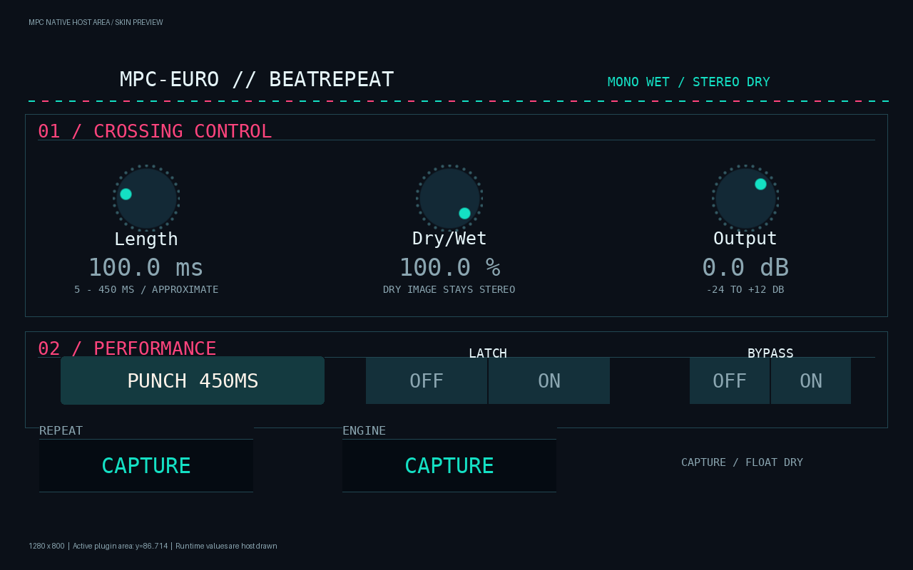

# MPC-EURO / BeatRepeat

Experimental, independent **SDK-free VST2 effect** for the original Akai MPC One (ARMv7/armhf, intended Hakai 3.9.1 target). This proof builds and passes Linux tests. **It has not been loaded on an MPC; device compatibility is unverified.** No installation, settings change or release is included.

BeatRepeat freezes a recent mono recording and repeats a window between positive zero crossings. Stereo dry audio stays stereo; the wet repeat is centered mono. Length is approximate, measured in milliseconds, and takes effect on the next repeat. This is a free-running performance effect, without tempo sync or MIDI/CV integration.

- Large touchscreen Length, Dry/Wet and Output controls.
- Latched Gate, prominent timed **Punch 450 ms** (tap again to cancel), and unity Bypass.
- Native MPC TUI and six Q-Link bindings, live parameter labels and repeat/engine status bindings.
- Smoothed controls, original core fades and a recording splice fade for repeated switching.
- Versioned scalar project state; history and performance gates are intentionally transient.



The preview composites the actual exported skin assets and approximates host-drawn initial labels. On-device rendering, touch gestures, autonomous status redraw and project recall still require separately approved hardware tests.

See [controls](docs/CONTROLS.md), [architecture and realtime audit](docs/ARCHITECTURE.md), [build/package instructions](docs/BUILD.md), [validation results](docs/VALIDATION.md), [provenance/licenses](docs/PROVENANCE.md) and [remaining hardware tests](docs/HARDWARE_TEST_PLAN.md). The original approved scope is [here](research/BEATREPEAT_PROOF_SCOPE.md).

```sh
make test
make sanitize
make skin
make arm
make package
```

Native builds need a C11 compiler, make, Python and Pillow. The ARM build uses the hash-pinned open-source Zig 0.13.0 toolchain; see the build guide before running these commands. Generated binaries and packages stay in ignored `build/`. No proprietary VST2 SDK, Daisy, CMSIS, RP2040 SDK or hardware firmware is required.

The DSP adaptation and new project code/art are GPL-3.0-only. Vendored MIT code, font and runtime notices retain their terms. Source publication is authorized for this proof; **final binary distribution rights must be reviewed separately**, as required by the approved scope. This project is independent of MPC-PD-LAB and does not alter other plugins or the research PRs.
