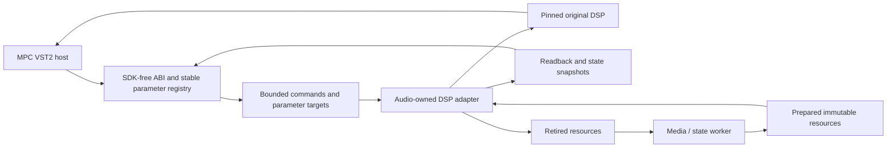

# Independent MPC VST2 architecture

Research/design only, 14 October 2026. Target is the original Akai MPC One running Hakai 3.9.1 / Linux ARMv7. **Nothing in this document authorizes deployment, MPC.settings edits, replacing plugins or device patches.** Exact target-device behavior remains a hardware validation task after separate approval.

## 1. Reuse baseline and its limits

Inspected baseline: [sd88me/mpc-vst-plugins](https://github.com/sd88me/mpc-vst-plugins/tree/4a8a25fb6fd41d51c9a4eaa4aeb7338df4070042), especially [engine.h](https://github.com/sd88me/mpc-vst-plugins/blob/4a8a25fb6fd41d51c9a4eaa4aeb7338df4070042/wrapper/engine.h), [vst2_wrap.c](https://github.com/sd88me/mpc-vst-plugins/blob/4a8a25fb6fd41d51c9a4eaa4aeb7338df4070042/wrapper/vst2_wrap.c), [build_port.sh](https://github.com/sd88me/mpc-vst-plugins/blob/4a8a25fb6fd41d51c9a4eaa4aeb7338df4070042/tools/build_port.sh) and [NOTES.md](https://github.com/sd88me/mpc-vst-plugins/blob/4a8a25fb6fd41d51c9a4eaa4aeb7338df4070042/docs/NOTES.md).

This provides MIT wrapper/tools code, independent VST2 ABI declarations, VSTPluginMain, separate effect/instrument modes, generated parameter tables, skins, Q-Links, plugin-list metadata, chunk state, offline host tests, release packaging and CPU benchmark tooling. Reuse these implementations with attribution and a pinned revision. [Boris](https://github.com/sd88me/mpc-vst-boris) supplies a compact existing effect adapter; [PlateauXXL](https://github.com/sunskiefer/PlateauXXL) supplies a C++ engine/build example and another ARM build route.

The baseline is not a drop-in fulfillment of the requested realtime design:

| Source-verified limitation | Proposed treatment |
| --- | --- |
| pthread mutex wraps set/get/MIDI/render/process per instance | Audio-owned DSP; bounded parameter/event handoff and readback snapshots. Priority inheritance does not make blocking acceptable. Retain correctness while removing shared engine mutation. |
| All engines use interleaved int16 audio | Keep a deliberate int16 path for fixed-point DSP; add a float path for Wreath/Plateau/Capicola/oooo. Avoid quantizing a native-float reverb or dry signal unnecessarily. |
| effSetSampleRate/effSetBlockSize/effMainsChanged just return success | Record negotiated rate/block/suspend state; support tested values, or reject/fail safely with explicit status. Do not silently play 48 kHz DSP at 44.1 kHz. |
| 8 KiB char buffer stores chunks | Small scalar state may fit; version/validate it. Larger engines need bounded variable state storage outside the render callback. Never embed megabytes of loop PCM in this buffer. |
| Generic block FIFO and sample-accurate instrument option; effects explicitly excluded from that option | Direct arbitrary-frame processing for capable engines; optional event splitting for triggered effects as new adapter work. Declare/verify latency for buffered engines. |
| Host callbacks/readback and string parsing may happen in render housekeeping | Keep audio work bounded; numeric parameter representation inside DSP, throttled display snapshots; host notifications outside engine mutation and, where feasible, off audio. |

Do not delete the mutex and retain cross-thread direct setters. That would restore exactly the data races the upstream wrapper guards against. Changes should be a small reviewed derivative in this independent project or a reusable upstream contribution later; no upstream PR is created in this phase.

## 2. Architecture and ownership



Proposed modules:

- **ABI layer:** hand-written MIT declarations/provenance from the community wrapper, lifecycle/dispatcher, parameters, programs, state and events. No Steinberg SDK headers or JUCE dependency.
- **Parameter registry:** stable index, key, units/range, mapping, default, enum labels, smoothing, automation permission, momentary behavior and state inclusion. One source generates ABI metadata and skin/Q-Link metadata.
- **Engine adapter:** instance create/prepare, stereo float or int16 process, timed event/control application, numeric state snapshot and failure/status reporting. DSP stays faithful to pinned upstream source.
- **Worker services:** bounded media loading, prepared-bank creation, parsing/validation, loop export, preset file storage and deferred reclamation. No mandatory network service.
- **Package tooling:** manifest, source/license ledger, native MPC skin, checksums, architecture/dependency validation and a separately invoked installer compatible with community registration.

DSP and transient history belong to each instance, including RNG, delay/record buffers, sequence and counters. No global mutable engine, shared SDRAM slot counter or shared rand/srand. Shared immutable tables are acceptable. A TLS selector in _core is an upstream implementation mechanism, not permission to call one instance concurrently.

### Realtime contract

Allocate, zero, size and touch buffers during creation/prepare or on workers. Process callbacks must not allocate/free, load files, log synchronously, wait on mutexes/conditions, perform network I/O, run processes or execute unbounded searches. Clear/reboot/resize must be bounded or prepare an inactive replacement on a worker. Garbage/resource reclamation occurs off audio, including final releases of shared_ptr-like objects that can destroy large buffers.

Parameter setters can come from more than one host thread. A naive SPSC queue is insufficient unless producers are explicitly serialized **off audio**. Use validated lock-free target atomics for scalar controls, with audio-rate/block-rate smoothing; use a bounded multi-producer-safe handoff for ordered commands, or one non-audio coordinator feeding an SPSC command queue. Check the actual 32-bit atomic implementation; don't assume uint64 or double atomics are lock-free.

Queue behavior must be specified: coalesce continuous targets, preserve record/capture/reset ordering, keep a reserved path for all-notes-off/release, reject excess commands with a status counter, and never silently drop a release that leaves a gate held. Audio processes a fixed maximum number per callback. Normalized values are finite/clamped; invalid parameters leave safe prior state.

Readback uses small nonblocking snapshots. Do not spin until a UI writer's seqlock completes on audio. Scalar atomics or a bounded immutable snapshot handoff work better; ownership of reusable snapshot slots needs acknowledgement so producer cannot overwrite a slot being read. A snapshot is not a full captured-audio save.

Catch allocation/init failure before host returns the plugin instance; produce a clear failed-load/status path rather than half-initialized audio. Check NaN/Inf at risky DSP boundaries, keep feedback bounded by each product's documented design, handle denormals, and test silence/tails. Safety conditioning must be transparent, with declared limiter latency if used, and must not hide broken DSP in fidelity tests.

## 3. Target ABI and reproducible builds

**Community reported:** Gen1 MPC/Force uses ARMv7 little-endian 32-bit hard-float userland; reference audio is 44.1 kHz / 128 frames and Force 3.x glibc is 2.39. The user specifies ARMv7; the exact Hakai One's ELF attributes, library versions, mount flags and audio settings have not been measured here. Don't ship an aarch64 build for this target.

Proposed first build baseline: pinned `arm32v7/gcc:11-bullseye` / `linux/arm/v7`, as used by community build_port.sh. It targets glibc 2.31 and supports existing MPC versions without requiring a newer runtime. Pin the **image digest**, compiler, binutils and Python generator dependencies before reproducible release; the inspected build script uses an image tag, which is not an immutable toolchain pin. QEMU can run an ARM container or binary for software tests; it cannot validate real CPU cost, host integration or audio timing.

Alternative observed route: PlateauXXL uses Zig with `arm-linux-gnueabihf.2.31`, explicit ARMv7/NEON/VFP attributes and C/C++ compilation. This is a useful proven-source build example, not something run here. Pick one baseline for the first release; don't combine arbitrary modern host C++ libraries with an old-glibc plugin.

Inspect final ELF32/ARM header, hard-float attributes, ARMv7 ISA, exported VSTPluginMain, unresolved symbols, NEEDED libraries and highest GLIBC/GLIBCXX/CXXABI requirements. Use hidden visibility/export map for all internal symbols to avoid collisions in MPC's process. Avoid x86 SSE dependencies; use scalar reference DSP first. Cortex-A17/NEON tuning is optional after target confirmation. Avoid unsafe-math flags until equivalence and corner cases are established.

C and C++ sources compile separately; don't compile the C wrapper as C++ to fix linking. Use appropriate standard (oooo needs at least C++17 features); verify libstdc++ requirements or a justified supported static runtime policy. Standard libc/libm remain target dependencies; don't ship a replacement glibc or change the device runtime. No mandatory Docker daemon on the MPC.

No installation or compilation is necessary in this research phase. Future build outputs belong in per-plugin build directories and are separate from documentation. Each plugin should build independently using the shared pinned kit; no MPC-PD-LAB checkout or installed plugin is a build dependency.

## 4. Audio, tempo, transport and events

Effects report two inputs/two outputs where the algorithm is stereo; instruments normally zero inputs/two outputs. An explicitly mono wet effect can accept stereo host input while preserving stereo dry routing. Report this clearly in UI/docs. DSP sample format is an adapter choice, not the VST external format: VST processReplacing uses float channels.

For fixed-point sources, clip/scale with defined conversions and test rounding/overflow; leave float dry/bypass untouched where possible. A fixed-point effect's character is intentional; float DSP should not take an unnecessary int16 round trip. Use no in-place alias assumption unless both host and engine path are tested.

Support actual frame count and buffer/null-input behavior during scan/load. An engine requiring 441 frames needs a preallocated FIFO with declared latency; it also needs worst-case burst profiling. Simple effect can process arbitrary slices, keeping a source fade-table length fixed at 128 samples when that preserves its chosen sound. Block-size change does not necessarily mean regenerate a fade table.

Time source: request audioMasterGetTime and check **tempo and PPQ validity flags** independently. Use audio sample counters for scheduling, never wall-clock sleeps for musical events. Define fallback free tempo/duration when flags absent. Detect play/stop, restart/locate, host loop and time discontinuity; don't assume PPQ always increases. Handle stopped time without dividing by zero or triggering repeated resets.

For samples/sequence, choose an explicit "follow host" versus "free run" behavior and retain original probability/sequence rules. Saved seed and sequence restore musical identity; snapshotting sample phase/tails is a separate optional behavior. For beat repeat, sync length is a requested zero-crossing span, not exact metrical chopping.

Queue MIDI note/control events by validated deltaFrames. Render segments between events for engines that support variable slices. Current community SAMPLE_ACCURATE mode applies only to instruments, so note-triggered effects need a deliberate extension. Bound event count and preserve release/all-notes-off behavior under overload. **Effect-slot MIDI routing on the user's One is unverified**; momentary parameter triggers must remain usable without it.

Normal VST MIDI output is **upstream reported ignored by MPC**, based on Force probes. A standalone generative MIDI plugin therefore needs a separate ALSA sequencer-port path. Prefer internal synthesis/sample sequencing initially. Optional ALSA sender must use a bounded audio-to-worker event handoff, avoid blocking sends on audio, avoid feedback loops and stuck notes, expose channel/port identity, and test host auto-subscription/recording/echo. Existing Force success does not establish exact Hakai behavior.

## 5. Parameters, Q-Links and native skin

Use independent manufacturer, product string, four-byte VST UID, binary basename and manifest package ID. Maintain a registry in this project to prevent collisions. Provisional names/UIDs are not final allocations. Never impersonate an existing plugin's UID or install path.

MPC stores automation by index: append parameters, never reorder/reuse indices after release. Keep state schema migration distinct from parameter numbering. Separate preset selection from record/reset actions; the current wrapper has a parameter-0 restore workaround, so audit it before deciding that index 0 is an ordinary momentary control.

Reuse generator support for `TUI.json`, `Q-Links.json`, version.xml and artwork, with original graphics and cleared font assets. Host draws declarative widgets; a plugin is not an unrestricted custom-drawn desktop UI. Current notes report empty native combobox pickers for VSTs, so prefer tested segmented selectors/popups. Map actual MPC One Q-Link banks, not Force's eight-knob geometry. Automated skin tests plus later actual-device usability tests are required.

Scalar controls should have sane physical units (ms, Hz, dB, ratios), logarithmic mappings where useful and short live value text. Display metadata is static or snapshot-backed. Triggers are momentary/event-like and are not recalled held. Feedback/record/freeze controls require explicit on/off/status behavior under project restore. Presets should never start recording merely by loading.

## 6. Preset and project state

VST flags/dispatchers: program chunks, effGetChunk/effSetChunk and supported program/preset queries. Community reports project/Program chunk recall; separate native save-preset UI behavior varies and the notes say it was not available for one tested instrument. Do not promise a full native preset workflow without testing this target.

Proposed state envelope contains magic, schema version, plugin identity, length and checksum; payload uses explicit named/versioned fields or defined-width endian encoding. Do not serialize raw C structs, pointer values, compiler padding or live thread handles. Validate every length, enum, count, number and relative path; cap total size; unknown newer schemas fail clearly or migrate without corruption. State buffers returned to the host need valid lifetime through the dispatcher contract.

Restore parses/prepares off audio, hands a validated state/resource command to audio, and publishes readback once applied. getChunk reads a published coherent snapshot; it must not lock audio to walk the entire engine. Decide how the host's immediate parameter updates interact with restored state and test the sequence actually used by MPC.

For beat repeat, presets/project state save scalar controls; current repeat/history and held trigger are deliberately reset. That is clearly documented transient-state policy, not full audio capture persistence.

For live loopers, faithful recall needs audio media. Store captures in a separate plugin-owned/user-selected project-media area, with stable relative references and hashes, worker-based save/load, atomic file completion and user-visible pending/missing status. Preset recall need not include recorded media; project recall may. Test moving a project, missing storage, modified media and save while recording. No writes into another plugin folder or shared factory banks. Don't claim project save completed while the capture export is still pending.

The host may not provide the project directory to VST2. **Project-relative persistence mechanism is unverified** and must be designed/tested; fallback is a user-managed plugin media root with explicit relocation rather than inventing a host API. This is a major later-looper blocker, not a requirement for the first transient beat-repeat proof.

## 7. Packaging and Hakai integration

Observed community folder convention (an example, not installation performed here):

```text
<separate-release>/
  portable/<OwnVendor> - VST - <OwnPlugin>/
    <own-plugin>.so
    version.xml
    Plugin Skins/
      TUI.json
      Q-Links.json
      <original-artwork>.png
    Presets/                  # only if this plugin supports the tested format
    manifest.json             # proposed project metadata, not a host requirement
  pluginlist-entry.xml
  INSTALL.md
  LICENSES/ and NOTICE
  SOURCE.md and matching-source archive
  checksums.sha256
  install.sh / uninstall.sh   # future, separately authorized deployment
```

Community generation uses per-plugin `vst.json`; the .so goes in a separate content folder, often under `/sdcard/Synths`, and registration uses pluginList-arm plus SynthContentLocations. version.xml/TUI/Q-Link assets serve host content discovery; `vst.json`/catalog JSON and our proposed manifest are build/release metadata, **not interchangeable native Hakai manifest formats**. Inspect actual generated files from the pinned tool before producing a release.

Manifest should record unique package ID, plugin UID/name/vendor/version/type, architecture/ABI, binary and asset hashes, minimum tested firmware, dependency revisions/licenses and source-archive hash. Declare measured device/firmware separately from desired compatibility; don't call Force testing "Hakai One verified".

Reuse the existing checksum/layout/ELF checks and installer registration algorithm where suitable. The conventional workflow **does edit MPC.settings** and may stop/restart MPC. Under current constraints it must not be invoked. Research-only artifacts do not register themselves. A future installer must require a separately authorized action, back up/recover settings, refuse path/UID conflicts, never overwrite existing plugins, and remove only owned files. Preserve user presets/media across updates. No PR merges or automatic hardware deployment as part of building.

Hakai-specific unknowns: actual service (`acvs` vs `inmusic-mpc`), settings location, content locations, mount exec/noexec policy, existing installer/addin hooks and Q-Link/event behavior. Upstream notes report service-detection fixes after **Hakai 2.15.1** users, not an exact 3.9.1 One validation. Read-only discovery later can establish these; don't blindly hardcode Force paths or remount disks. Separate packages/directories do not eliminate the need for host registration.

## 8. MPC CV/Gate: separate integration work

The user's original MPC One has eight CV/Gate outputs; **no plugin API granting direct access was verified**. Do not add raw hardware-device access or undocumented writes to the audio callback.

| Possible path | Evidence and limitation | Proposed verification |
| --- | --- | --- |
| Native MPC CV program/track driven by the user's sequence | Native MPC feature is a possible integration concept; routing from this plugin to such a track is unverified | User-approved hardware test for MIDI source selection, pitch calibration, gates, transport, latency and recording. |
| Plugin ALSA sequencer port → MPC track configured for CV | Separate MIDI-port detection is reported on Force; exact One CV routing is not established | Check supported input routing and feedback loops; measure CV timing and stop/all-notes-off behavior. |
| Plugin MIDI → external MIDI-to-CV interface | Standard external integration concept; device-specific conversion/USB/DIN route not tested | Verify port selection, channel and note/gate mapping; calibrate external device. |
| Internal CV-like modulation | Fully implementable inside DSP; requires no physical CV API | Treat as normalized control signals; do not label them hardware output jacks. |
| Direct /dev or undocumented Akai CV service access | No verified interface in inspected sources | Excluded from baseline; separate investigation only if later requested. |

Host tempo/gate parameters, MIDI notes and actual physical CV are different signals and must stay distinct in documentation. CV integration is optional and does not block an audio-only proof.

## 9. License architecture and binary release gate

The shared kit can remain MIT, preserving upstream notices. Each linked plugin inherits the obligations of its DSP: GPL-3.0-only for the _core desktop combination, GPLv3-or-later for Plateau where explicitly granted, AGPLv3 for Capicola, or MIT for fully cleared Wreath/Smack combinations. Do not make the entire collection falsely "MIT" just because the wrapper is MIT. Separate source repositories/packages simplify the license boundaries but do not waive linked-component obligations.

For GPL/AGPL plugins, ship exact Corresponding Source and build/install scripts, dependency pins, generation inputs, third-party notices and change records. Actual compiled components determine the bill of materials. Don't bundle Rack/Gen/proprietary SDK/uncleared artwork or sample packs without a separate audited grant. GPL allows selling covered code; artwork NC conditions apply to the artwork, not a power to change GPL code permissions.

The inspected wrapper states its VST2 ABI is hand-written and no Steinberg SDK is used. That is the preferred route. Before distributing binaries, audit independent declaration provenance and actual license terms, avoid Steinberg logos/certification claims, and evaluate host/plugin separate-work questions. A proprietary SDK grant with incompatible restrictions cannot be overridden by a GPL wrapper license. A VST3 agreement is not a VST2 agreement. Official [VST2 discontinuation reference](https://helpcenter.steinberg.de/hc/en-us/articles/4409561018258-VST-2-Discontinued) was blocked during this session; current official terms were not independently verified.

No blanket legal clearance is claimed for a new developer distributing VST2 plugins. This is a specific pre-release gate, not a reason to copy proprietary DSP or delay source-only architecture research. Respect the Infinite Digits/Ectocore derivative-name restriction, retain attribution and use original vendor/product artwork.

## 10. Validation plan after approval

1. Source/ABI/packaging review and file-level license inventory; no device mutation.
2. Upstream reference DSP versus adapter fixtures, silence/impulse/music, boundaries, allocation failure, parameter extremes and independent instances.
3. Native x86 sanitizer host tests, chunk fuzz/round-trip, timing/event tests, alias/null inputs and arbitrary frame sizes. Preserve command exit status and actual test counts.
4. ARMv7 build/ELF/ABI inspection and QEMU correctness checks. Explicitly distinguish these from physical-MPC performance.
5. Approved hardware read-only characterization, then separately approved non-conflicting test installation. Never write settings merely to "probe".
6. Real MPC One/Hakai smoke: insert audio request/listening, stereo routing, Q-Link touch/automation, stop/play/loop, save/reopen, preset semantics, multiple instances and large-project stability.
7. Worst-case CPU and RSS/peak allocations on the target, plus stress/soak and recovery. The community [benchmark](https://github.com/sd88me/mpc-vst-plugins/blob/4a8a25fb6fd41d51c9a4eaa4aeb7338df4070042/docs/BENCH.md) suggests p99 ≤15% / worst ≤50% of a 2.9 ms block for comfortable use; treat that as a proposed budget, not measured readiness. Use wall/callback latency as well as thread CPU so blocking/preemption is not hidden.

Worker-paced engines need actual wall-clock/thread utilization measurement; the community notes explain why an unpaced synthetic benchmark can undercount worker cost. Test _core 441-frame bursts and commands like large clear/capture specifically. Passing average CPU or an offline host probe cannot certify this target.
